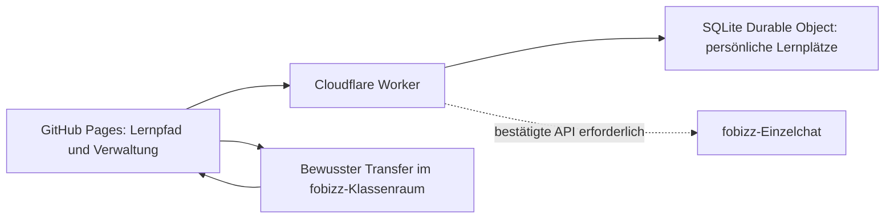

# Adaptive Lernpfade

Stand: 3. November 2026. Lokal eingerichteter Pilot, Version 3.0. Keine Veröffentlichung durch diese Einrichtung.

## Einstieg

- Lernende: [Lernpfad mit Demo](../gemeinsam/adaptive-lernpfade/index.html).
- Lehrkräfte: [Verwaltung](../gemeinsam/adaptive-lernpfade/admin.html).
- Quellen und Worker: [werkzeuge/adaptive_lernpfade](../werkzeuge/adaptive_lernpfade/README.md).
- Betrieb: [Einrichtung](../werkzeuge/adaptive_lernpfade/EINRICHTUNG.md), [Architektur](../werkzeuge/adaptive_lernpfade/ARCHITEKTUR.md), [API](../werkzeuge/adaptive_lernpfade/api/VERTRAG.md).

Das ZIP `Lernpfad_GitHub_Cloudflare_fobizz_Starter.zip` ist die Grundlage. Seine Folgeprompts sind Referenzmaterial, keine automatisch auszuführenden Arbeitsaufträge. Die Umsetzung verwendet das vorhandene Repository und dessen GitHub-Pages-Workflow.

## Aufteilung



Die Oberfläche bietet `single_chat` und `classroom` mit getrennten Verfügbarkeitsanzeigen. Der Einzelchat benötigt keinen fobizz-Klassenraum. Die Lehrkraft konfiguriert die erlaubten Modi, den Standardmodus und den Übertragungsweg des Klassenraums. Der vorhandene `room.fobizzUrl` bleibt die einzige Quelle des geschützten Klassenraumlinks.

Die aktuelle automatische fobizz-Anbindung ist **nicht freigeschaltet**. Der Adapter verweigert Aufrufe, bis ein unterstützter Providervertrag implementiert ist. Es gibt keine erfundene API-Adresse. Der Unterrichtsablauf mit adaptiven Aufgaben, Lerncodes und bewusstem Klassenraumtransfer ist vorbereitet; die lokale Demo funktioniert sofort.

Als erster geprüfter Aufgabenbestand ist der Starter „Bewegung verstehen“ übernommen: Geschwindigkeit, Umstellen und Einheiten. Er ist im Materialkatalog bei Klasse 7 / proportionale Zuordnungen eingeordnet. Die gemeinsame technische Plattform liegt unter `gemeinsam`; weitere Fachbestände benötigen eigene geprüfte Aufgabenvorlagen und stabile Lernpfadkennungen. Es handelt sich noch nicht um einen Generator für sämtliche Mathematikthemen.

## Was bereits eingerichtet ist

- Persönliche Lerncodes, Wiederanmeldung mit gespeichertem Fortschritt und Lehrkraftverwaltung.
- Serverseitige Moduswahl mit Revisionen, Modusversion und getrennten persönlichen Chatkontexten.
- Chatablauf mit Eingabegrenzen, Zeitlimit, Wiederholungsschutz und Verwerfen veralteter Antworten. Dieser Teil wird mit einem ausdrücklich injizierten Testadapter geprüft; der produktive Adapter bleibt gesperrt.
- Empfehlungen und Folgeaufgaben werden getrennt geprüft. Geprüfte Vorlagen bestimmen Zahlen, Einheiten und Lösungen. Die aktuelle Aufgabe wird während ihrer Bearbeitung nicht ausgetauscht.
- Chathilfe zählt als Unterstützung, eine Chatfrage erhöht keine Kompetenznachweise.
- Verlaufsbegrenzung und Löschwege für Verlauf, Lernplatz und Raum. Eine Löschung bei fobizz wird nicht zugesagt.
- Build im bestehenden Pages-Workflow; Quellen, Worker und Zugangsdaten gelangen nicht in `_site`.

## Lokal prüfen

Voraussetzung: Node.js 24 und Python. Im Repository-Stamm:

```powershell
npm.cmd --prefix werkzeuge/adaptive_lernpfade test
python werkzeuge/build_site.py
python werkzeuge/site_pruefen.py
python werkzeuge/struktur_pruefen.py
python -m unittest discover -s tests
```

`build_site.py` erzeugt zunächst beide Lernpfadseiten aus `src/`, danach die gesamte Website. Die öffentlichen HTML-Dateien und `_site` werden nicht von Hand bearbeitet. Der bisherige Workflow veröffentlicht weiterhin erst nach einem ausdrücklich beauftragten Push auf `main`.

Für die Browserprüfung: lokalen Worker nach der [Einrichtungsanleitung](../werkzeuge/adaptive_lernpfade/EINRICHTUNG.md) auf Port 8790 starten, anschließend `python tests/run_adaptive_lernpfade_browser.py`. Benötigt Playwright, Edge und WebKit. Das Skript verwendet Port 8000, stellt die Worker-Adresse ausschließlich in seiner lokalen Vorschau um und löscht seine Testräume anschließend. Keine externen KI-Aufrufe.

## Für den Livebetrieb noch einzutragen

1. Cloudflare-Worker veröffentlichen und zwei unabhängige Secrets `TEACHER_KEY` / `CODE_PEPPER` interaktiv setzen.
2. Die tatsächlich veröffentlichte Worker-Adresse in `werkzeuge/adaptive_lernpfade/config.public.json` eintragen und neu bauen.
3. In der geschützten Verwaltung Lerngruppe und Codes erzeugen; für Klassenraumtransfer den tatsächlichen fobizz-Link hinterlegen.
4. Für Livechat offizielle Providerdokumentation und Zugang beschaffen und den Adapter darauf abbilden. [Vorbereitete Klärungsfragen](../werkzeuge/adaptive_lernpfade/FOBIZZ_API_KLAERUNG.md).

Produktive Secrets wurden nicht angelegt, Cloudflare und GitHub wurden nicht verändert. Die lokale `.dev.vars` dient ausschließlich der getrennten Laufzeitprüfung und gehört nicht zum Deployment.
