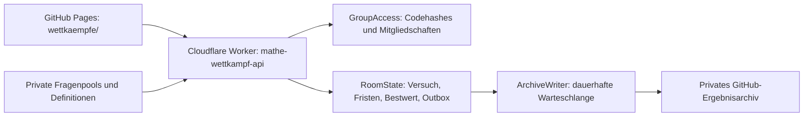

# Mathematikwettbewerbe einrichten

Stand: 27. Oktober 2026.

Aus dem Mathematikteil von `Wettkampf_Architekturen_Mathe_Physik.zip` ist eine
vorbereitete Anwendung entstanden: ein öffentliches Portal, ein separates
Cloudflare-Backend, Verwaltungswerkzeuge und eine lokale Vorschau. Das Portal ist
in die Materialsammlung eingebunden. Cloudflare-Konto, private GitHub-Repositories,
Tokens und Veröffentlichung werden beim tatsächlichen Einrichten verbunden.

## Schnell zum Ergebnis

Die vollständige lokale Backend-Arbeitskopie liegt in
`.local/wettkaempfe/Material_Mathe_Wettkampf_API/`. Sie ist durch die vorhandene
`.gitignore` ausgeschlossen und wird nicht nach `_site/` kopiert.
Ein transportables Backend-Paket liegt unter `.local/wettkaempfe/Mathematik_Wettkampf_Backend.zip`.
Es enthält keine Testzugangsliste, installierten Pakete oder Laufzeitdaten.

Die Arbeitskopie lässt sich aus dem ursprünglichen ZIP und den versionierten
Adaptern erneut vorbereiten:

```powershell
python werkzeuge/wettkampf_vorbereiten.py "C:\Users\johar\Downloads\Wettkampf_Architekturen_Mathe_Physik.zip" --paket
```

Vorhandene Fragenpools und Wettbewerbsdefinitionen werden dabei erhalten.
Die Adapter werden aus `werkzeuge/wettkampf_backend/` aktualisiert; eigene
Adapteränderungen deshalb dort pflegen oder vor einer Aktualisierung sichern.

Das Portal liegt unter `wettkaempfe/index.html`. Solange `apiBaseUrl` in
`wettkaempfe/config.js` leer ist, zeigt es einen verständlichen Vorbereitungshinweis.
Es simuliert keine echte Wettbewerbsteilnahme.

```powershell
# Im Materialrepository: Seite erzeugen
python werkzeuge/build_site.py

# Im vorbereiteten privaten Backend:
Set-Location .local/wettkaempfe/Material_Mathe_Wettkampf_API
npm ci
npm run check
npm test
npm run test:integration
npm run deploy:check

# Isolierte Vorschau ohne Cloud-Konto starten:
npm run vorschau -- --site ../../../_site
```

Die Vorschau meldet ihre Portaladresse und den Pfad zu einer privaten CSV mit zwei
temporären Probezugängen. Gruppenkennung: `klasse-9-demo`. Die CSV enthält
Pseudonym und Code; die Codes werden im Anmeldeformular eingegeben. Die drei
Proberunden sind nur innerhalb dieser Vorschau freigegeben. Die Quelldefinitionen
bleiben Entwürfe. Mit Strg+C enden Vorschau und temporäre Spielstände.

Falls Python und Node nicht global installiert sind, sind für diese Arbeitskopie
bereits lokale Laufzeiten unter `.local/python/` und `.local/node/` vorhanden.
Bei der späteren Nutzung genügt eine normale Installation von Python 3.12 und Node.js 24+.

Für die bereits vorhandenen lokalen Laufzeiten, ausgehend vom Materialrepository:

```powershell
$env:Path = (Resolve-Path '.local/node/node-v24.22.1-win-x64').Path + ';' + $env:Path
& '.local/python/cpython-3.12.14-windows-x86_64-none/python.exe' werkzeuge/build_site.py
Set-Location .local/wettkaempfe/Material_Mathe_Wettkampf_API
npm run vorschau -- --site ../../../_site
```

## Aufbau



| Ablage | Inhalt |
| --- | --- |
| `wettkaempfe/` | Portal, Konfiguration ohne Secrets, Abbildungen und lokales KaTeX |
| `werkzeuge/wettkampf_backend/` | Versionierbare Adapter und Prüfwerkzeuge ohne Lösungsschlüssel oder Zugangsdaten |
| `werkzeuge/wettkampf_vorbereiten.py` | Führt Adapter und Mathematikvorlage in der privaten Arbeitskopie zusammen |
| `.local/wettkaempfe/Material_Mathe_Wettkampf_API/` | Vollständiges Backend einschließlich privater Fragenbank für ein separates privates Repository |
| `Hardenacke/Material_Mathe_Ergebnisse` | Vorgesehener privater Archivspeicher; Name ist konfigurierbar |

Jede Gruppe hat ihr eigenes Zugangsobjekt. Jede Kombination aus Wettbewerb, Version
und Wertungszeitraum hat einen eigenen Spielraum. Ein Archivschreiber ordnet die
Schreibvorgänge dieses Fachs. Der Physikteil des ZIPs wurde nicht übernommen.
Die fachliche Sollstruktur bleibt bei 9 Bereichen, 33 Inhaltsfeldern und 105 Themen.

## Onlinebetrieb einrichten

1. Die vorbereitete Backend-Arbeitskopie an einen dauerhaft privaten Ablageort übernehmen
   und gegebenenfalls ein separates **privates** Repository dafür einrichten.
   Im öffentlichen Materialrepository nur Portal, Adaptervorlagen und Leitfaden pflegen.
2. Ein **privates** Ergebnisrepository mit initialer README und Zweig `main` anlegen.
   Namen und Zweig in `wrangler.jsonc` kontrollieren. Der Schreiber verweigert
   das Schreiben in ein öffentliches Ergebnisrepository.
3. Im privaten Backend `npm ci` und die oben genannten Prüfungen ausführen.
4. Eine Wettbewerbsdatei unter `wettkaempfe/` für die eigene Lerngruppe anpassen.
   Poolversion, Jahrgang, Termin, Regeln und Status bewusst festlegen. Erst die
   gewählte Definition auf `published` setzen. Für weitere Inhalte einen neuen
   privaten Fragenpool und eine passende Konfiguration anlegen.
5. Mit `npx wrangler login` beim eigenen Cloudflare-Konto anmelden.
   Über `npx wrangler secret put ADMIN_TOKEN` einen separaten, zufälligen
   Verwaltungszugang hinterlegen: mindestens 32 Base64url-Zeichen, vorzugsweise
   32 zufällige Bytes. Über `npx wrangler secret put GITHUB_TOKEN` ein auf das
   private Ergebnisrepository begrenztes Token mit `Contents: read/write` hinterlegen.
   Secrets werden interaktiv eingegeben und nicht in Konfigurationsdateien abgelegt.
6. `ALLOWED_ORIGINS` auf den tatsächlichen Ursprung des Portals begrenzen, zum Beispiel
   `https://hardenacke.github.io`. Ein Repositorypfad gehört nicht zum Ursprung.
   Lokale Ursprünge werden für eine reine Produktivkonfiguration entfernt.
7. `npm run deploy:check` und danach, beim tatsächlichen Veröffentlichen,
   `npm run deploy` ausführen. Die Konfiguration erzeugt drei neue SQLite-Namespaces
   für `GroupAccess`, `RoomState` und `ArchiveWriter`.
8. Die zurückgegebene HTTPS-Workeradresse als `apiBaseUrl` in der öffentlichen
   `wettkaempfe/config.js` eintragen. Danach Materialseite bauen und prüfen.
9. Persönliche Zugänge erzeugen und importieren, zunächst mit zwei eigenen Testgeräten
   prüfen und erst danach an die Lerngruppe ausgeben.

Ein bestehender Worker `mathe-quiz-api` wird dabei nicht verändert. Das neue System
verwendet `mathe-wettkampf-api` und einen getrennten Archivpfad `architektur-v1`.
Es gibt keine Übernahme alter Punktestände oder alter Zugangscodes.

## Wettbewerbe und Regeln

| Veranstaltungsform | Konfiguration | Wertung |
| --- | --- | --- |
| Klassenwettbewerb | Festes Start-/Enddatum, üblicherweise ein Versuch | Bester beendeter Versuch im Teilnahmefenster |
| Dauerwertung | `continuous`, kein Enddatum | Persönlicher Bestwert in `gesamt` |
| Monatswertung | `calendar-month`, `Europe/Berlin` | Eigener Bestwert pro Kalendermonat |

Mitgeliefert sind drei Entwürfe für Klasse 9, quadratische Funktionen, und zwölf
Demo-Fragen. Der Pool enthält vier unabhängige Aufgabenfamilien pro Stufe; die
Standardauswahl nutzt alle zwölf. Für regelmäßig wiederholte Wettbewerbe den Pool
fachlich erweitern. Andere Jahrgänge und Themen lassen sich über weitere Pools
ergänzen; das Portal und die API bleiben gleich.

Standard: drei Leben, 60 Sekunden je Frage, 100 Grundpunkte und bis zu 900
Zeitbonuspunkte. Eine richtige Antwort nach 15 Sekunden gibt 775 Punkte,
nach 30 Sekunden 550 Punkte. Falsch, übersprungen oder ab Fristablauf: ein Leben
weniger und keine Punkte. Nur beendete Versuche erscheinen in der Rangliste.
Es werden Bestwerte gespeichert, keine Punktesummen über mehrere Versuche.
Gleichstände erhalten Plätze wie 1, 1, 3.

Zwischen Fragen kann pausiert werden. Ein Versuch endet standardmäßig spätestens
nach 30 Minuten und immer spätestens an der Monats- beziehungsweise Wettbewerbsgrenze.
Eine geöffnete Frage läuft nach Tabwechsel und Verbindungsverlust weiter.
Bei Monatsende zählt der vorhandene Teilstand für den Startmonat; ungeöffnete
Fragen kosten keine zusätzlichen Leben. Die Serverzeit entscheidet.

Eine Klasse spielt innerhalb desselben Fensters, aber mit individuellen Fragebeginnen.
Ein synchrones Live-Duell mit gemeinsamer Frage zur selben Sekunde gehört nicht zu
dieser Fassung. Der Übungsbereich der Materialsammlung bleibt eigenständig;
Übungsergebnisse gehen nicht in Wettkampfranglisten ein.

Der Status `closed` verhindert neue Versuche. Bereits gestartete Versuche bleiben
bis zu ihrer gespeicherten Endfrist fortsetzbar; die Wertung bleibt im Portal sichtbar.
Ein festes Veranstaltungsende daher vor der Freigabe als `schedule.endsAt` planen.
Mit `archived` wird die Definition aus der Auswahl genommen; bekannte eigene
Versuchspfade bleiben innerhalb der Aufbewahrung abrufbar.

## Zugänge verwalten

Im privaten Backend, beispielsweise für den Dauerwettbewerb:

```powershell
npm run codes -- --gruppe klasse-9-demo --anzahl 30 --wettkaempfe mathematik-quadratische-funktionen-dauer
```

Das Werkzeug erzeugt eine private JSON-Importliste mit SHA-256-Codehashes sowie
eine CSV für die Ausgabe an die Lernenden unter `verwaltung/`. Jeder persönliche
Code besteht aus 32 zufälligen Bytes. Mehrere Wettbewerbs-IDs werden kommasepariert
angegeben; die IDs müssen zu dieser Gruppe gehören. Neue Klassen benötigen eigene
Wettbewerbsdefinitionen mit eigener ID und `groupId`.

Für den Import denselben Verwaltungszugang verwenden, der als `ADMIN_TOKEN`
im Worker hinterlegt wurde. In PowerShell kann er ohne Bildschirmausgabe eingelesen werden:

```powershell
$wettkampfSecret = Read-Host 'Verwaltungszugang' -AsSecureString
$env:WETTKAMPF_ADMIN_TOKEN = [System.Net.NetworkCredential]::new('', $wettkampfSecret).Password
npm run verwaltung -- importieren --gruppe klasse-9-demo --datei verwaltung/DEINE-LISTE.json --api https://DEIN-WORKER.workers.dev
Remove-Item Env:WETTKAMPF_ADMIN_TOKEN
```

`sperren`, `entsperren` und `codewechsel` bearbeiten gezielt einen Zugang anhand
seiner internen ID. Anschließend die aktualisierte JSON-Liste erneut importieren:

```powershell
npm run verwaltung -- sperren --datei verwaltung/DEINE-LISTE.json --id p-DEINE-ID
npm run verwaltung -- codewechsel --datei verwaltung/DEINE-LISTE.json --id p-DEINE-ID
```

Ein Codewechsel schreibt den neuen Klartextcode ausschließlich in eine zusätzliche
private CSV. Ein Import ersetzt die Mitgliedschaften der enthaltenen Personen;
nicht enthaltene Personen bleiben bestehen. Zum Entziehen eines Zugangs diesen
explizit sperren und importieren. Sperren gelten ab dem nächsten geschützten Request.
Zugangscodes gehören nie in URLs, Schülerseiten oder öffentliche Repositories.
Das Portal hält sie nur im Arbeitsspeicher des Tabs. Nach Neuladen erneut anmelden;
der Server nimmt denselben aktiven Versuch mit unveränderter Fragefrist wieder auf.

## Speicherung, Archiv und Wiederherstellung

SQLite-Transaktionen verbinden Spielzug, Leben, Punkte, Bestwert und Outboxrevision.
Schreibanfragen benötigen eine UUID als `Idempotency-Key`. Eine Wiederholung mit
gleichem Inhalt liefert dieselbe Wirkung. Derselbe Schlüssel für andere Inhalte
oder Operationen wird mit 409 abgewiesen. Fällige Fristen werden auch dann committed,
wenn die nachfolgende Spielaktion ungültig ist.

RoomState speichert Definitions- und Poolfingerabdruck. Eine veränderte Definition
unter derselben Version blockiert neue Versuche. Aktive Versuche verwenden ihren
gespeicherten Fragen- und Regelschnappschuss. Eine neue fachliche Definition braucht
eine neue Version; ein Serverneustart setzt keine Spielstände zurück.

Der RoomState-Alarm wertet Fristen aus und liefert Archivaufträge an den
ArchiveWriter. Der Schreiber bestätigt erst, wenn GitHub die betreffenden Dateien
gespeichert hat. HTTP-Fehler oder Netzwerkausfälle bleiben in der dauerhaften
Warteschlange und werden mit wachsendem Abstand erneut versucht. Live-Spielzüge
bleiben davon unabhängig. Alte Revisionen können neuere Dateien nicht überschreiben.
Ein Konflikt zwischen verschiedenen Speicherinstanzen wird gesperrt und muss
administrativ geprüft werden.

Archivpfade enthalten Fach, Wettbewerb, Version und Zeitraum:

```text
snapshots/architektur-v1/mathematik/ID/v1/ZEITRAUM/latest.json
perioden/architektur-v1/mathematik/ID/v1/ZEITRAUM/final.json
```

Das Archiv enthält Pseudonyme, Punkte und Plätze; keine Zugangscodes, Codehashes,
Lösungsschlüssel oder Einzelantworten. `latest.json` enthält den letzten bestätigten
Ranglistenstand. `final.json` entsteht am festgelegten Periodenende. Die unbefristete
Gesamtwertung hat ohne Enddatum keinen automatischen endgültigen Abschluss.

Beendete Detailversuche werden nach `DETAIL_RETENTION_DAYS` (Standard: 90) gelöscht.
Versuchszähler, Bestwertzusammenfassungen und Zugangsverwaltung bleiben bestehen,
damit Löschen alter Details keine Versuchslimits zurücksetzt. Idempotenzbelege gelten
sieben Tage. Bestwertarchive und die Writer-Auftragsnachweise bleiben für die
Nachvollziehbarkeit bestehen; deren langfristige Aufbewahrung ist organisatorisch
festzulegen. Gesperrte Zugänge werden nicht automatisch physisch gelöscht.

Die Ranglistendateien sind kein Restore für aktive Spiele oder Zugänge. Für einen
Wiederanlauf dieselben Cloudflare-Namespaces und denselben Worker weiterverwenden.
Bei beschädigtem Zustand zuerst den betroffenen Dienst über Cloudflares
Wiederherstellungsfunktionen prüfen. Neue Namespaces erzeugen neue Instanzen;
bei einem bewussten Neustart einen neuen Wettbewerb beziehungsweise ein neues
Archivpräfix verwenden. Automatischer Import von Ranglisten in aktive Spiele ist
nicht implementiert. Es gibt keine Verwaltungsoberfläche für Restore oder Löschaufträge.

## Prüfstand und Abnahme

Das ergänzte Prüfprotokoll steht in `dokumentation/WETTBEWERBE_PRUEFUNG.md`.
Für den echten Betrieb nach Hinterlegung der eigenen Konten zusätzlich auf zwei
physischen Geräten prüfen: getrennte Zugänge, Wiederaufnahme nach Neuladen,
Tabwechsel, gemeinsame Rangliste, Sperre und Codewechsel sowie langsame Verbindung.
Safari und VoiceOver müssen auf einem echten iPad abgenommen werden; die lokale
Edge-Prüfung ersetzt das nicht. Vorbereitete Demo-Inhalte sind kein fachlich
freigegebener Pool für dauerhafte Leistungsvergleiche.

Technische Primärquellen:

- [Cloudflare: SQLite-Speicher und Transaktionen](https://developers.cloudflare.com/durable-objects/api/sqlite-storage-api/)
- [Cloudflare: dauerhafte Alarme](https://developers.cloudflare.com/durable-objects/api/alarms/)
- [Cloudflare: Durable-Object-Migrationen](https://developers.cloudflare.com/durable-objects/reference/durable-objects-migrations/)
- [GitHub: Repository Contents API](https://docs.github.com/en/rest/repos/contents)

Diese Quellen wurden bei der Umsetzung geprüft. Die konkrete Aufteilung und die
hier gewählten Betriebsregeln sind Entscheidungen dieser Anwendung.
