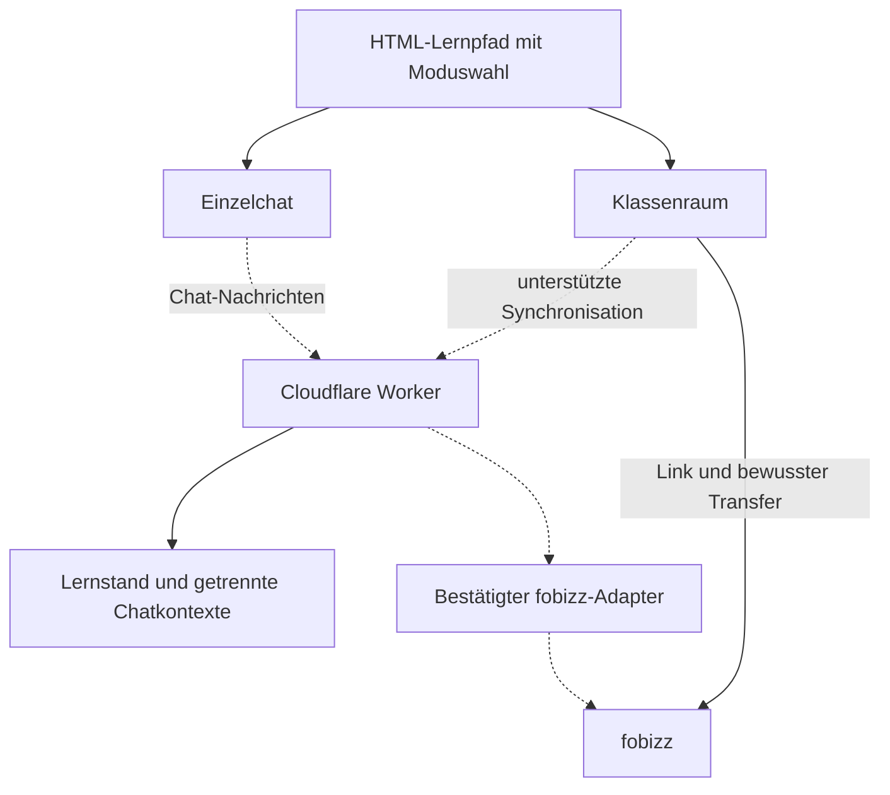

> Referenz aus dem Starterpaket. Aktueller implementierter Stand: [Architektur Version 3](ARCHITEKTUR.md). Enthaltene Folgeprompts sind keine automatisch auszuführenden Anweisungen.

# fobizz-Anbindung an adaptive HTML-Lernpfade

**Technische Übergabe und Arbeitsgrundlage für Folgeprompts**  
Stand: 3. November 2026 · Codebasis: Starter Version 2.0. Dokumentation erweitert um die Zielarchitektur mit Einzelchat und Klassenraummodus; diese Erweiterung ist noch nicht im Laufzeitcode implementiert.

## 1. Auftrag und Verwendung dieser Datei

Ein adaptiver Lernpfad wird als einzelne HTML-Datei auf GitHub Pages bereitgestellt. Lernende melden sich ausschließlich mit einem individuellen Lerncode am eigenen Cloudflare-Klassenzimmer an. Das System speichert ihren Lernstand, passt Aufgaben aus geprüften Vorlagen an und soll fobizz als unterstützenden KI-Lernbegleiter einbeziehen. Vorgesehen sind zwei wählbare Lernmodi: persönlicher **Einzelchat über Cloudflare** und optional eingebundener **fobizz-Klassenraum**. Chatantworten und geprüfte Leistungen sollen für folgende Aufgaben, Hilfen, Formulierungen und Zahlenwerte genutzt werden.

Diese Datei ist für spätere Programmieraufträge bestimmt. Sie erklärt den vorhandenen Anschluss, seine Grenzen, die relevanten Dateien, Datenformate und die Umsetzung einer möglichen automatischen Erweiterung. Sie ist keine fobizz-API-Dokumentation und enthält keine Zugangsdaten.

Für einen Folgeauftrag diese Datei **zusammen mit dem aktuellen Projekt-ZIP oder dem Repository** bereitstellen. Wenn der aktuelle Quellcode fehlt, kann eine Architektur geplant werden; Änderungen an angeblich vorhandenen Dateien dürfen dann nicht vorgetäuscht werden. Zuerst den aktuellen Quellstand lesen. Bei Abweichungen vom beschriebenen Stand ist der tatsächliche Code maßgeblich; Änderungen am Integrationsvertrag ausdrücklich dokumentieren.

Referenzpaket: `Lernpfad_GitHub_Cloudflare_fobizz_Starter.zip`, Version 2.0. Im zugehörigen Prüfbericht sind 32 bestandene lokale Tests dokumentiert. Ein produktives GitHub-/Cloudflare-Deployment und ein tatsächlicher fobizz-API-Aufruf sind dadurch nicht belegt.

## 2. Beide Lernmodi und ihr aktueller Implementierungsstand

| Lernmodus | Soll verfügbar sein | Tatsächlicher Stand der Codebasis |
|---|---|---|
| `single_chat` – Einzelchat über Cloudflare | Persönlicher Chat im HTML, Fragen an fobizz und daraus geprüfte Folgeaufgaben | Als Zielarchitektur spezifiziert. Chatoberfläche, Kontextverwaltung und Live-Provideraufruf sind noch zu implementieren; API-Zugang nicht bestätigt. |
| `classroom` – optionaler fobizz-Klassenraum | Von der Lehrkraft hinzugefügter Klassenraum mit individuellem Lernen und Rückmeldungen | Klassenraumlink und manueller Lernstandstransfer vorhanden. Einheitliche Modusauswahl, Einbettung und automatische Synchronisation sind noch zu implementieren beziehungsweise zu bestätigen. |

Beide Modi verwenden denselben eigenen Cloudflare-Lernstand. **Lernmodus und Übertragungsweg sind zwei getrennte Einstellungen.** Der vorhandene Übertragungsweg `fobizz-transfer` ist keine vollständige Beschreibung des gewünschten Modusangebots.

Ein fobizz-Freigabelink oder Schülercode ist kein API-Schlüssel. Die individuellen Lerncodes unseres Klassenzimmers sind keine fobizz-Zugangscodes. Ein eigener Lerncode ermöglicht keine automatische Anmeldung bei fobizz.

Dass fobizz selbst Modellanbieter über APIs anspricht, beweist keine externe API für kundeneigene HTML-Anwendungen. Eine Schul- oder Landeslizenz belegt für sich genommen keine Berechtigung zu einer solchen Schnittstelle. Nicht behaupten, eine fobizz-API existiere grundsätzlich nicht; Zugang und Vertrag sind für dieses Projekt offen und vor einer späteren Implementierung erneut zu prüfen.

## 3. Zielarchitektur mit Einzelchat und Klassenraum



Das Diagramm beschreibt die erweiterte Zielarchitektur. Die gestrichelten automatischen Verbindungen sind noch nicht implementiert. Der bestehende eigene Cloudflare-Klassenraum und der manuelle Transfer bleiben erhalten.

Die HTML-Datei enthält künftig die Modusauswahl, den persönlichen Chat und den Klassenraumzugang. Cloudflare übernimmt Aufgabenprüfung, Lernstand, Moduszuordnung und begrenzte Gesprächskontexte. Zahlenwerte, Referenzlösungen und die endgültige Aufgabensteuerung bleiben unter Kontrolle der Fachlogik.

### Zwei gleichzeitig vorgesehene Lernmodi

**Verbindliche Zielanforderung:** Beide Modi gehören zum selben Lernpfad und müssen als wählbare Optionen vorgesehen werden. Der Einzelchat darf nicht durch einen Klassenraumzwang ersetzt werden; das Hinzufügen eines Klassenraums darf den Einzelchat nicht entfernen. Die Auswahl liegt innerhalb der von der Lehrkraft freigegebenen Konfiguration.

| Modus | Fachlicher Ablauf | Konfiguration | Ziel der Adaptivität |
|---|---|---|---|
| `single_chat` – persönlicher Einzelchat | Lernende stellen im HTML Fragen. Cloudflare vermittelt sie mit einem begrenzten Lernkontext an fobizz. Die Antwort erscheint im persönlichen Chat. | Serverseitige, offiziell unterstützte fobizz-Anbindung und persönliche Gesprächszuordnung; **kein fobizz-Klassenraum erforderlich**. | Hinweise, Feedback und Vorschläge für folgende Aufgaben, Formulierungen, Zahlenwerte und Hilfen. |
| `classroom` – fobizz-Klassenraum | Die Lehrkraft hinterlegt einen Klassenraum beziehungsweise einen passenden freigegebenen Zugang. Lernende nutzen die dort bereitgestellten Assistenten. | Geschützt gespeicherter Klassenraumlink; Einbettung und automatische Datenübernahme nur bei dokumentierter Unterstützung. | Derselbe geprüfte Anpassungsprozess; zunächst per bewusstem Transfer, später gegebenenfalls automatisch. |

Mit „Klassenraum“ ist hier der zusätzliche **fobizz-Klassenraum** gemeint. Der eigene Cloudflare-Schulbereich bleibt die Grundlage für Lerncodes und gespeicherte Lernstände. Ein vorhandener eigener Lerncode kann auch den Einzelchat öffnen, ohne dass ein fobizz-Klassenraumlink hinterlegt ist. Ein öffentlicher, unbegrenzter Selbstregistrierungsdienst wird damit nicht eingeführt.

Der Einzelchat im HTML ist ein eigener Dialog je Lernplatz. Auch im Klassenraummodus bleiben die Dialoge individuell, sofern nicht ausdrücklich eine separate Gruppenfunktion beauftragt wird. Niemals den Gesprächsverlauf der gesamten Klasse als gemeinsamen Lernkontext verwenden.

### Lernmodus und Übertragungsweg getrennt konfigurieren

- `learningMode`: `single_chat` oder `classroom` – beschreibt die pädagogische Nutzung.
- `transportMode`: `fobizz-api` oder `fobizz-transfer` – beschreibt den technischen Datenaustausch und wird für jeden Lernmodus separat festgelegt. So können Einzelchat per API und Klassenraum per manuellem Transfer gleichzeitig angeboten werden.
- Die vorhandene Variable `COACH_MODE` beschreibt bisher nur den vorgesehenen Übertragungsweg. Sie darf die neue Lernmoduswahl nicht ersetzen.

Beispiel einer **geplanten serverseitigen Konfiguration**, noch kein vorhandenes Eingabeschema:

```json
{
  "allowedLearningModes": ["single_chat", "classroom"],
  "defaultLearningMode": "single_chat",
  "singleChat": {
    "transportMode": "fobizz-api",
    "assistantRef": null
  },
  "classroom": {
    "transportMode": "fobizz-transfer",
    "url": null
  }
}
```

Das Beispiel verlangt für den Einzelchat einen noch einzurichtenden API-Zugang; `assistantRef: null` bedeutet nicht einsatzbereit. Der Klassenraum kann unabhängig davon beim manuellen Transfer bleiben. Nicht durch einen einzigen globalen Schalter beide Wege zwangsweise gleichsetzen.

`assistantRef` wird erst anhand der tatsächlich unterstützten fobizz-Schnittstelle definiert; es ist keine erfundene Providerkennung. `classroom.url` bildet in der späteren Konfiguration den bereits vorhandenen Wert `room.fobizzUrl` ab. Kein zweites widersprüchliches Linkfeld parallel betreiben. Zugangsdaten bleiben in Cloudflare-Secrets; diese Konfiguration gehört nicht ungeprüft in öffentliches HTML.

Die Oberfläche soll beide Modi mit verständlichem Status führen: nutzbar, Einrichtung nötig oder automatische Schnittstelle noch nicht bestätigt. Einen Live-Chat nicht vortäuschen, wenn nur eine Modusauswahl oder ein Link vorhanden ist. Ohne nutzbaren API-Zugang bleibt der Einzelchat ein ausgewiesenes Ausbauziel. Ein manueller Einzelchat-Transfer ist nur mit einem tatsächlich zulässigen und für die betreffende Person nutzbaren fobizz-Einzelzugang vorzusehen; er darf nicht heimlich einen Klassenraum voraussetzen.

### Einzelchat: Frage → Antwort → nächste passende Aufgaben

1. Lernende melden sich mit ihrem eigenen Lerncode an und wählen `single_chat`.
2. Sie können eine Frage eingeben, beispielsweise „Warum muss ich hier durch 3,6 teilen?“. Die Oberfläche ordnet aufgabenbezogene Fragen der aktuellen Aufgabe zu.
3. Cloudflare prüft Sitzung, gewählten Modus, aktuelle Aufgabe und Revision. Es erstellt einen minimierten Kontext aus relevanten Lernbeobachtungen, der geprüften Aufgabenstellung, nötigen fachlichen Parametern, der Frage und einem begrenzten persönlichen Gesprächsverlauf. Eine vollständige Musterlösung wird nicht ungefragt mitgegeben.
4. Der offiziell unterstützte fobizz-Adapter liefert eine Chat-Antwort und gegebenenfalls eine strukturierte didaktische Empfehlung. Er wählt keine Person oder fremde Gesprächskennung anhand von Browserangaben aus.
5. Die Chat-Antwort wird als Text angezeigt. Die Empfehlung wird getrennt gegen den aktuellen Lernstand validiert.
6. Die Fachlogik wählt daraus gegebenenfalls einen nächsten Schwerpunkt, eine zulässige Aufgabenvorlage, Zahlenwerte innerhalb geprüfter Grenzen, eine Formulierungsvariante und passende Hilfen. Sie berechnet die Referenzlösung selbst.
7. Die folgende Aufgabe erscheint nach Abschluss der aktuellen Aufgabe. Eine bereits bearbeitete Aufgabenstellung oder deren Zahlenwerte werden nicht während der Bearbeitung ausgewechselt.

Eine Frage ist kein Nachweis einer neu erworbenen Kompetenz. Chatfragen, Selbsteinschätzungen und tatsächlich geprüfte Lösungen getrennt erfassen. Wird im Chat eine Hilfe zur aktuellen Aufgabe gegeben, muss diese Unterstützung bei der Einstufung „selbstständig ohne Hilfe“ berücksichtigt werden. Solche Erfolge dürfen nicht nachträglich als vollständig selbstständig gezählt werden.

Freie Fragen und Modellantworten sind fachliche Daten. Sie dürfen keine Zugriffsrechte, erlaubten Modi oder Aufgabenvorlagen erweitern. Die KI darf Vorschläge liefern, aber keine Erfolge, Punkte oder Musterlösungen erfinden. Ein bloßer Wunsch nach einer schwierigeren Aufgabe erhöht nicht automatisch den gespeicherten Kompetenznachweis.

### Klassenraum: optional hinzufügen und weiter individuell arbeiten

1. Die Lehrkraft fügt einen fobizz-Klassenraumlink geschützt hinzu oder ändert ihn in der Verwaltung.
2. Lernende können zusätzlich `classroom` wählen. Der Zugang wird nach ihrer eigenen Anmeldung ausgeliefert.
3. Der Klassenraum kann über einen Button geöffnet werden. Eine Einbettung ist optional und nur zulässig, wenn fobizz sie technisch unterstützt; eine alternative Öffnung muss erhalten bleiben.
4. Ohne bestätigte Synchronisation werden Lernstand und Rückmeldung bewusst übertragen. Ein Klassenraumlink allein ermöglicht weder das Mitlesen von Chats noch das automatische Auswerten der dortigen Ergebnisse.
5. Mit einer dokumentierten Schnittstelle werden nur die Rückmeldungen des jeweiligen Lernplatzes übernommen und durch dieselbe Aufgabensteuerung geprüft.

Beide Modi müssen denselben fachlichen Fortschritt fortführen. Der Wechsel ändert den Gesprächskontext, nicht den bisher erreichten Lernstand. Vorherige Klassenraumrechte dürfen keinen Zugriff auf Einzelchats anderer Lernender ermöglichen.

### Moduswechsel, Chatverlauf und Vorschläge für eigene Endpunkte

Die Auswahl wird serverseitig am Lernplatz gespeichert. Ein zusätzliches `modeVersion` beziehungsweise ein gleichwertiger Kontextnachweis erhöht sich bei einem Wechsel. Ausstehende Anfragen des alten Modus dürfen anschließend keine Aufgabenanpassung mehr auslösen. Chatverläufe und etwaige Provider-Gesprächskennungen werden je Lernplatz, Lernpfad und Modus getrennt geführt. Providerkennungen bleiben serverseitig.

**Geplante eigene Cloudflare-Endpunkte, keine vorhandenen und keine fobizz-URLs:**

| Methode / Pfad | Vorgesehener Zweck |
|---|---|
| `GET /api/coach/capabilities` | Freigegebene Modi und ihre tatsächlich konfigurierte Verfügbarkeit anzeigen. |
| `PATCH /api/learning-mode` | `{requestId, revision, modeVersion, learningMode}` prüfen und den Modus ohne Fortschrittsverlust wechseln. |
| `GET /api/chat/history` | Nur den eigenen Verlauf des serverseitig gewählten Modus laden. |
| `POST /api/chat/messages` | `{requestId, revision, modeVersion, message, taskId?}` verarbeiten; Antwort und getrennte validierte Empfehlung liefern. |

Die bereits vorhandenen Endpunkte `/api/coach/packet` und `/api/coach/apply` bleiben für den manuellen Transfer erhalten. `/api/coach/automatic` bleibt das Ausbauziel für automatische didaktische Rückmeldungen. Die zusätzlichen Endpunkte sind erst nach Implementierung funktionsfähig.

Für die spätere Implementierung kann der Adapter einen internen Umschlag aus `chatReply`, optionaler `recommendation` nach dem bestehenden Schema und optionalem `taskPlan` liefern. Dieser Umschlag ist ein **eigener Entwurf**, keine Behauptung über das fobizz-Antwortformat. Die konkrete Providerantwort wird ausdrücklich darauf abgebildet.

`taskPlan` darf nur registrierte Vorlagen und geprüfte Parameterbereiche referenzieren. Ein solcher Vorlagenkatalog und seine Validierung sind zusätzlich zu implementieren; der aktuelle Starter besitzt noch keinen allgemeinen KI-Aufgabengenerator. Zahlenwerte, Einheiten, Lösbarkeit und Referenzlösungen werden nach der Auswahl überprüft. Freier KI-Code oder beliebige HTML-Aufgaben werden nicht ausgeführt. Die bisherigen `speed`-/`rearrange`-/`units`-Regeln bleiben bis zu einer ausdrücklich geprüften Erweiterung maßgeblich.

Freie Chattexte erweitern die bisherige Datenverarbeitung: geeignete Eingabe- und Verlaufslimits, kontextbezogene Löschung und den Umgang mit persönlichen Angaben vorsehen. Nicht ungefragt vollständige Gesprächsverläufe versenden. Chatdaten dürfen die Frist des zugehörigen Lernplatzes nicht überdauern. Beim Löschen eines Lernplatzes beziehungsweise Raums müssen neue Chat- und Kontextdatensätze einbezogen werden. Eine Löschung bei fobizz kann nur über die tatsächlich vorhandenen Providerfunktionen zugesagt werden.

## 4. Relevante Dateien im vorhandenen Projekt

Alle Pfade sind relativ zum Projektordner `adaptiver-lernpfad/` im ZIP.

| Datei | Vorhandene Funktion / Bedeutung für Folgeaufträge |
|---|---|
| `src/domain.mjs` | Fachaufgaben, `coachPacket(state)`, `applyCoach(state, recommendation)` und begrenzte Adaptivität |
| `src/app.js` | Lernendenanmeldung, API-Anfragen, Transferpaket, Import und Textdarstellung |
| `src/page.html` | Oberfläche einschließlich fobizz-Transferbereich |
| `src/admin.js`, `src/admin.html` | Klassenraumverwaltung, geschütztes Hinterlegen und Ändern des fobizz-Links |
| `worker/index.mjs` | Worker-Gateway, Klasse `School`, Rollenprüfung, persistente Profile und Coach-Endpunkte |
| `worker/security.mjs` | Code-Hashing, Sitzungstokens, Eingabegrenzen und erlaubte fobizz-Linkhosts |
| `worker/fobizz-adapter.mjs` | Gesperrte Funktion `callFobizz(packet, env)`; wirft `FOBIZZ_API_NOT_CONFIRMED` |
| `worker/legacy-v1.mjs` | Alte Klasse für die v1-Migration; nicht zur neuen KI-Anbindung verwenden |
| `wrangler.toml` | Bindung `SCHOOL`, Migrationen und bisherige Modusvariable |
| `config.public.json` | Öffentliche Worker-Adresse, Titel, lokale Demo; keine Geheimnisse |
| `FOBIZZ_ASSISTENT.md` | Rollenbeschreibung für einen in fobizz angelegten Assistenten |
| `FOBIZZ_API_KLAERUNG.md` | Fragen zur offiziell unterstützten automatischen Anbindung |
| `tests/domain.test.mjs`, `tests/worker.test.mjs` | Bestehende Vertrags-, Rollen-, Persistenz- und Adaptivitätstests |
| `scripts/build.mjs` | Erzeugt `docs/index.html` und `docs/admin.html` aus den Quellen |

**Wichtiger Implementierungsbefund:** Der automatische Endpunkt gibt in Version 2.0 unmittelbar HTTP 501 zurück. `worker/index.mjs` importiert beziehungsweise ruft den Adapter derzeit nicht auf. Nur den Adapter zu befüllen oder `COACH_MODE` zu ändern aktiviert deshalb keine automatische Verbindung. Gateway, Ablaufsteuerung, Rückmeldung und Oberfläche müssen dafür tatsächlich ergänzt werden.

Quellen bearbeiten und danach neu bauen. Änderungen ausschließlich an `docs/index.html` oder `docs/admin.html` würden beim nächsten Build überschrieben.

## 5. Bereits umsetzbarer fobizz-Transfer

### Einrichtung durch die Lehrkraft

1. Im eigenen fobizz-Zugang einen Lernassistenten erstellen. Die Rollenbeschreibung aus Abschnitt 9 beziehungsweise `FOBIZZ_ASSISTENT.md` verwenden.
2. Den Assistenten über einen für die Lerngruppe geeigneten fobizz-Klassenraum freigeben. Dafür die jeweils aktuelle offizielle fobizz-Anleitung verwenden.
3. Den Schülerzugang selbst prüfen. Einen Kollegiums-/Remix-Link nicht ungeprüft als Lernendenzugang behandeln.
4. In unserer `admin.html` den passenden eigenen Klassenraum öffnen und den fobizz-Link hinterlegen.
5. Der Link bleibt im serverseitigen Raumdatensatz `room.fobizzUrl`. Nach erfolgreicher Lernendenanmeldung wird er als `fobizzClassroomUrl` ausgegeben.

Im Referenzcode sind für solche Links ausschließlich HTTPS-Adressen auf `app.fobizz.com`, `go.fobizz.com` und `tools.fobizz.com` erlaubt. Bei einer offiziellen Änderung die Prüfung in **Worker und Oberfläche** konsistent aktualisieren. Keine beliebigen Fremdhosts freigeben.

Der Link kann selbst eine Zugangsberechtigung enthalten. Er gehört nicht ins öffentliche Repository oder in `config.public.json`. Die eigene Anmeldung ersetzt eine von fobizz verlangte Codeeingabe nicht.

### Ablauf für Lernende

1. Mit dem persönlichen Lerncode am HTML-Lernpfad anmelden.
2. Mindestens zwei Aufgaben abschließen.
3. „Lernstand für fobizz vorbereiten“ wählen.
4. Den erzeugten Text in den freigegebenen fobizz-Assistenten kopieren.
5. Die reine JSON-Antwort zurückkopieren und „Rückmeldung prüfen und übernehmen“ wählen.
6. Die Rückmeldung lesen; der empfohlene Schwerpunkt wird bei einer folgenden Aufgabe berücksichtigt.

Während eines Transfers die Bearbeitung pausieren. Antwort, Hinweis oder Aufgabenwechsel verändern die Revision und machen ein älteres Paket ungültig. Ein neu erzeugtes Paket ersetzt auch bei gleicher Revision die bisherige Paketkennung. Nach erfolgreicher Anwendung ist das Paket verbraucht.

Der manuelle Import kann die Herkunft einer Antwort aus fobizz nicht beweisen. Er ist als Unterstützung beim Üben vorgesehen.

## 6. Vorhandene eigene API-Endpunkte

Die folgenden **vorhandenen** Endpunkte gehören unserem Cloudflare Worker, nicht fobizz. Die zusätzlich geplanten Chat- und Modus-Endpunkte stehen getrennt in Abschnitt 3. Die tatsächliche Worker-Basisadresse wird öffentlich konfiguriert.

| Methode / Pfad | Eingabe / Zweck |
|---|---|
| `POST /api/session` | `{code}`: individuellen Lernplatz öffnen |
| `GET /api/state` | Aktuellen eigenen Lernstand laden |
| `POST /api/coach/packet` | `{requestId, revision}`: Transferpaket erzeugen |
| `POST /api/coach/apply` | `{requestId, revision, recommendation}`: Rückmeldung validieren und speichern |
| `POST /api/coach/automatic` | `{requestId, revision}`: bisher HTTP 501; Ausbauziel |
| `PATCH /api/admin/rooms/:roomId` | Mit Lehrkrafttoken `{fobizzUrl}` zum Link-Hinterlegen beziehungsweise Ändern |

Außer der Sitzungserstellung verlangen diese Aufrufe die passende Rolle und `Authorization: Bearer <Sitzungstoken>`. Eine zulässige Origin ist zusätzlich erforderlich. Das Token des Lernpfads darf nicht an fobizz weitergereicht werden.

`requestId` ist eine UUID pro logischer Aktion; bei einer technischen Wiederholung dieselbe Kennung wiederverwenden. `revision` stammt aus dem zuletzt erhaltenen `state.revision`. Erfolgreiche Aufgabenmutationen werden im vorhandenen Protokoll begrenzt idempotent beantwortet. Veraltete Stände führen zu HTTP 409; dann den aktuellen Stand laden und keine neueren Eingaben überschreiben.

`coachPacket(state)` gibt `{packetId, prompt}` zurück. `prompt` enthält die Rollenhinweise, das gewünschte Antwortschema und ein kompaktes Kompetenzprofil. Der Worker antwortet am Paket-Endpunkt zusätzlich mit dem öffentlichen Lernstand und anderen eigenen Sitzungsdaten. **Nicht die vollständige Worker-Antwort an fobizz übertragen**, sondern nur das dafür erzeugte Transferpaket beziehungsweise den minimierten Prompt.

## 7. Erlaubte fachliche Beobachtungen

Das aktuelle Fachmodul ist gleichförmige Bewegung. Seine Kompetenzschlüssel sind:

| Schlüssel | Bedeutung |
|---|---|
| `speed` | Geschwindigkeit berechnen |
| `rearrange` | Formeln umstellen |
| `units` | Einheiten umrechnen |

Das Transferprofil enthält `completed`, `skills` und `recent`. Pro Kompetenz werden unter anderem Anforderungsstufe, selbstständige Erfolge, Abschlüsse, Erfolgsserie und beobachtete Fehlversuche geführt. `recent` umfasst höchstens zwölf abgeschlossene Aufgaben mit Kompetenz, Stufe, Versuchszahl und Hinweisnutzung.

Nicht übertragen: Lerncodes, Sitzungstokens, Code-Prüfwerte, Lehrkraftschlüssel, Raumbezeichnungen, Lernplatzkennungen, Namen, E-Mail-Adressen oder vollständige Klassenlisten. Im Referenztransfer werden auch keine aktuellen numerischen Lösungen oder freien Schülertexte mitgeschickt. Der geplante Einzelchat ergänzt ausdrücklich eingegebene Fragen und begrenzte Gesprächsbezüge; dafür gelten die zusätzlichen Anforderungen aus Abschnitt 3. Diese neue Verarbeitung nicht als bereits vorhanden darstellen.

Daraus folgt eine fachliche Grenze: fobizz kann aus diesem Profil keine konkreten Rechenfehler erklären, die gar nicht erfasst sind. „Hinweis benötigt“ ist ein Beleg für Unterstützung; es beweist beispielsweise keinen bestimmten Umstellfehler. Für eine spätere Fehlerdiagnose gezielt zusätzliche geprüfte Beobachtungen modellieren.

Bei einem anderen Fach oder Thema müssen Kompetenzschlüssel, Aufgabenmodell, Rollenbeschreibung, Ausgabeschema und Tests gemeinsam angepasst werden. Die drei Physikschlüssel nicht ungeprüft für neue Lernpfade übernehmen.

## 8. Verbindliches Antwortschema

Beispiel einer zulässigen Antwort; die Paketkennung ist hier nur ein Demonstrationswert und muss im Betrieb exakt aus dem aktuellen Paket stammen:

```json
{
  "schemaVersion": 1,
  "packetId": "8feac903-cb83-4da6-9a2e-4bac4ea5021f",
  "feedback": "Die Geschwindigkeit hast du bereits selbstständig berechnet. Übe als Nächstes das Umstellen der Formel und prüfe dabei die Einheiten.",
  "nextFocus": "rearrange",
  "challenge": "support"
}
```

| Feld | Prüfung |
|---|---|
| `schemaVersion` | Exakt `1` |
| `packetId` | Exakt die aktuelle gespeicherte Paketkennung |
| `feedback` | Nicht leerer String, maximal 500 Zeichen gemäß bestehender JS-Längenprüfung |
| `nextFocus` | Genau `speed`, `rearrange` oder `units` |
| `challenge` | Genau `maintain`, `support` oder `increase` |

JSON ohne Markdown-Codeblock, Einleitung oder Nachsatz. Die erlaubten Alternativen sind keine mit senkrechten Strichen verbundenen Feldwerte.

`applyCoach(state, recommendation)` ist die vorhandene zentrale Prüfung. Danach wird `learner.lastFeedback` persistent gespeichert. Feedback wird ausschließlich als Text angezeigt; kein `innerHTML`, kein JavaScript und keine beliebigen Rechenanweisungen aus der KI-Ausgabe ausführen.

Die KI darf weder Referenzlösungen ändern noch Abschlüsse oder selbstständige Erfolge erzeugen. Sie setzt einen nächsten Schwerpunkt. `support` senkt die Anforderung höchstens um eine Stufe. `increase` erfordert im Referenzcode mindestens drei belegte selbstständige Erfolge der Kompetenz und bleibt innerhalb der fachlich abgesicherten Stufenbegrenzung. Die endgültige Entscheidung trifft die lokale Fachlogik.

### Bereits identifizierter Randfall für den nächsten Codeauftrag

Die aktuelle `increase`-Berechnung muss vor einer Erweiterung korrigiert beziehungsweise abgesichert werden: `independent` zählt Erfolge dauerhaft, der Nachweis `proven` wird aber nur aus der auf zwölf Abschlüsse gekürzten Historie berechnet. Fehlt dort die betreffende Kompetenz, kann `increase` die Anforderung unbeabsichtigt senken.

Bei der Dokumentprüfung reproduziert: `speed.level = 2`, `speed.independent = 3`, zwölf jüngste Abschlüsse ausschließlich in `units`; eine ansonsten gültige `increase`-Empfehlung für `speed` führte zu Stufe 1. Die vorhandenen 32 Tests decken diesen Randfall nicht ab. Dieser Dokumentauftrag verändert den Projektcode nicht.

Ein Folgeauftrag soll einen Regressionstest ergänzen und eine fachlich begründete Korrektur implementieren: Bei unzureichenden aktuellen Belegen muss eine Erhöhungsanfrage den Stand unverändert lassen; sie darf ihn nicht absenken. Alternativ dauerhafte, passend definierte Kompetenzbelege führen. Neue Datenfelder benötigen eine Migration für vorhandene Lernstände. Den Ausgabevertrag dabei erhalten.

## 9. Rollenbeschreibung zum Kopieren nach fobizz

```text
Du bist ein freundlicher Lerncoach für Physik zum Thema gleichförmige Bewegung.
Du erhältst ausgewählte Beobachtungen aus einem HTML-Lernpfad. Verwende nur diese Belege.

Formuliere eine kurze Rückmeldung mit einem beobachtbaren Erfolg und einem konkreten
nächsten Übungsschritt. Sprich Lernende direkt, verständlich und sachlich ermutigend an.
Keine Noten, Diagnosen, Lerntypen, Intelligenzaussagen oder Vergleiche mit anderen.
Erfinde keine Fehlerursachen oder Leistungen. Bei wenigen Beobachtungen vorsichtig formulieren.
Gib keine Lösung der aktuellen Aufgabe vor. Frage nicht nach persönlichen Angaben.

Erlaubte Schwerpunkte:
speed = Geschwindigkeit berechnen
rearrange = Formeln umstellen
units = Einheiten umrechnen

Erlaubte Empfehlungen:
maintain = festigen, bei unsicherer Datenlage Standard
support = zusätzliche Unterstützung beziehungsweise geringere Anforderung
increase = vorsichtige Erhöhung bei mehreren belegten selbstständigen Erfolgen

Liegt ein Transferpaket vor, antworte ausschließlich mit einem JSON-Objekt:
schemaVersion: 1
packetId: unverändert aus dem Paket
feedback: nicht leer, höchstens 500 Zeichen
nextFocus: genau einer der erlaubten Schwerpunktwerte
challenge: genau einer der erlaubten Empfehlungswerte

Keine Markdown-Codeblöcke und keine zusätzlichen Erklärungen außerhalb des JSON-Objekts.
Der Lernpfad prüft die Empfehlung zusätzlich und kann Aufstiege begrenzen.
Ohne Transferpaket erkläre kurz, wie ein aktuelles Paket im Lernpfad erzeugt wird.
```

## 10. Voraussetzungen einer automatischen fobizz-Anbindung

Vor einem echten automatischen Aufruf müssen folgende Angaben aus offizieller Dokumentation beziehungsweise einer ausdrücklichen fobizz-Bestätigung vorliegen:

| Benötigte Angabe | Bisheriger Stand |
|---|---|
| Für externe eigene Anwendungen freigegebene API und Nutzungsberechtigung | Offen |
| Exakte Basisadresse, Endpunkt und HTTP-Methode | Offen |
| Unterstützte Authentifizierung und sichere Bereitstellung | Offen |
| Kennung eines nutzbaren Assistenten/Modells und Einbindung seiner Rollenbeschreibung | Offen |
| Request-/Response-Schema, Fehlercodes, Limits und Kosten | Offen |
| Trennung von Lernendenkontexten, Aufbewahrung und Löschung | Offen |
| Passende schulische Vertrags- und Datenverarbeitungsgrundlage | Zu klären |

Keine URL wie eine angebliche fobizz-Chat-API erfinden. Keine OpenAI-Kompatibilität unterstellen. Keine Login-Cookies, Freigabetokens oder Schülercodes zu API-Zugangsdaten umdeuten. Keine internen Web-Endpunkte nachbauen und keinen anderen KI-Anbieter ohne entsprechenden Auftrag einsetzen.

Fehlen diese Angaben, die automatisch blockierten Teile genau benennen und unabhängig davon Transfer, Oberfläche, Tests und Dokumentation fertigstellen. Nicht pauschal das gesamte Projekt anhalten.

## 11. Ausbauplan für bestätigten API-Zugang

**Dieser Abschnitt ist ein Implementierungsauftrag für später, keine Beschreibung vorhandener Funktionen.**

### A. Adapter vervollständigen

`worker/fobizz-adapter.mjs` anhand des tatsächlich bestätigten fobizz-Vertrags implementieren. Der Adapter erhält nur das minimierte Paket und die serverseitige Konfiguration. Die didaktische Empfehlung wird in das Schema aus Abschnitt 8 übersetzt. Für den Einzelchat kommen eine getrennte Chatantwort und bei Bedarf ein zusätzlich geprüfter Aufgabenvorschlag gemäß Abschnitt 3 hinzu. Beide Lernmodi ausdrücklich unterstützen; einen fobizz-Klassenraumlink nicht zur Voraussetzung des Einzelchats machen.

Authentifizierungsgeheimnisse ausschließlich als Cloudflare-Secrets hinterlegen. Ihre Bezeichnungen aus der tatsächlich benötigten Authentifizierung ableiten; ein vorgeschlagener Variablenname wäre noch kein Beleg, dass fobizz diese Art von Schlüssel ausgibt. Zieladresse und Assistentenkonfiguration werden serverseitig festgelegt und dürfen nicht frei vom Lernenden vorgegeben werden.

Timeout, Antwortgrößenlimit und nachvollziehbare Fehlerbehandlung ergänzen. Bei ausbleibender beziehungsweise schemawidriger Antwort keine Empfehlung anwenden. Providerantworten, Zugangsdaten und vollständige Lernverläufe nicht in Logs schreiben.

### B. Worker-Ablauf wirklich verbinden

Den bisher gesperrten Endpunkt `/api/coach/automatic` mit dem Adapter verbinden. Den externen Modellaufruf **außerhalb** der vorhandenen Speichertransaktion und der schulweiten `blockConcurrencyWhile`-Sperre ausführen. Sonst könnte ein langsamer Aufruf die Bearbeitung anderer Lernender blockieren.

Erforderliche Phasen:

1. **Kurz reservieren:** Sitzung, Rolle, Lernplatz, Codeversion, offenen Raum und Frist prüfen; aktuelle Revision, Lernmodus, Modusversion und Paketkennung festhalten; Budget und ausstehende Anfrage atomar reservieren.
2. **Extern ausführen:** Ausschließlich das reservierte minimierte Paket über den Adapter senden. Die Fachbearbeitung anderer Anfragen bleibt möglich.
3. **Kurz übernehmen:** Lernplatz und Zugang erneut laden. Raum darf nicht inzwischen geschlossen, abgelaufen oder gelöscht sein. Sitzung und Codeversion müssen weiterhin passen. Revision, Lernmodus, Modusversion und Paketkennung müssen unverändert sein. Dann validierte Empfehlung und Rückmeldung atomar speichern.
4. **Andernfalls verwerfen:** Keine gelöschten Profile aus einem alten Snapshot wiederherstellen und keine veraltete Empfehlung auf einen neueren Lernstand anwenden.

Dafür werden interne Reservierungs-/Übernahmeoperationen beziehungsweise eine geeignete Koordination benötigt. Sie sind im Starter noch nicht vorhanden. Interne Operationen nicht als ungeschützte öffentliche URL bereitstellen.

Idempotenz muss auch **laufende** KI-Anfragen berücksichtigen. Die bisherige Sammlung erfolgreicher Aufgabenantworten reicht dafür allein nicht. Doppelte Klicks oder Retries dürfen nicht unkontrolliert neue Provideraufrufe erzeugen. Bei Providern ohne passende Idempotenzunterstützung ist nach einem unklaren Timeout kein blindes Wiederholen zulässig; eine Garantie „genau ein kostenpflichtiger Aufruf“ wäre dann unbelegt.

### C. Gezielte Auslösung in der Oberfläche

Feedback nach abgeschlossenen Aufgaben beziehungsweise auf bewusste Anforderung auslösen. Als Startwerte für die spätere Umsetzung eignen sich ein Aufruf nach jeweils vier abgeschlossenen Aufgaben und ein Mindestabstand von 45 Sekunden. Diese Werte sind Vorschläge, bislang keine implementierten KI-Aufrufgrenzen.

Eine gleichzeitige Bearbeitung darf weitergehen. Kommt das Ergebnis für einen überholten Lernstand zurück, wird es verworfen oder erst nach einem neuen passenden Auftrag erzeugt. Die Oberfläche muss diesen Zustand verständlich behandeln. Ein KI-Aufruf nach jedem Tastendruck ist nicht erforderlich.

Die Zielintegration umfasst ausdrücklich den persönlichen Einzelchat und den optionalen Klassenraummodus. Freie Fragen werden auf bewusste Eingabe verarbeitet, automatische Lernstandsfeedbacks nach klaren Ereignissen. Folgeaufgaben können Schwerpunkt, Vorlage, geprüfte Zahlenwerte, Formulierungsvariante und Hilfen anpassen. Dafür den in Abschnitt 3 beschriebenen validierten Vorlagenkatalog ergänzen. Beliebige ungeprüfte KI-Aufgaben sind dadurch nicht freigegeben.

### D. Betriebsarten und Fehler

Die Lernmoduswahl `single_chat` / `classroom` und den manuellen Übertragungsweg `fobizz-transfer` erhalten. Den automatischen Übertragungsweg `fobizz-api` erst als einsatzbereit anbieten, wenn Adapter, Worker-Verbindung, Authentifizierung und Tests wirklich funktionieren. `GET /api/health` darf automatische Bereitschaft nicht allein aus einer geänderten Modusvariable ableiten.

Bei KI-Ausfall bleiben geprüfte Aufgaben, Hinweise und bereits gespeicherte Lernstände nutzbar. Keine andere Person zuordnen, keine neue lokale Übung stillschweigend starten und keine andere KI als unsichtbaren Ersatz verwenden. Technische Quoten und Providerlimits getrennt behandeln; eigene Aufrufgrenzen garantieren keine absolute Obergrenze aller Infrastrukturkosten.

## 12. Erhaltenswerte Zugangs- und Speicherregeln

- Lerncode: zufälliger persönlicher Zugang, im Referenzprojekt 20 Zeichen in vier Fünfergruppen. Server speichert den HMAC-Prüfwert mit stabilem geheimem `CODE_PEPPER`.
- Sitzung: zwei Stunden für Lernende, eine Stunde für Lehrkraft; Token nur im Tab-Arbeitsspeicher. Eine neue Anmeldung ersetzt die vorherige Sitzung derselben Rolle beziehungsweise desselben Lernplatzes.
- Lernstand: bleibt beim Abmelden erhalten und wird mit demselben Code wieder geöffnet.
- Codeersatz: alter Code und alte Sitzung ungültig, Lernstand bleibt erhalten.
- Klassenraum: feste Frist von 7–365 Tagen, Standard 90; spätere Anmeldung verlängert sie nicht.
- `TEACHER_KEY` und `CODE_PEPPER` gehören weder in das HTML noch in Prompts oder öffentliche Konfiguration. `SCHOOL_ID` nicht ohne Migrationsplan ändern.
- Vorhandene Cloudflare-Migrationen nicht umbenennen. Version 2 verwendet `School`; die Klasse `LearningRoom` bleibt für die alte Migration erhalten.

Auch ein namenloser zuordenbarer Lernverlauf kann personenbezogen sein. Die vorhandene fobizz-Bereitstellung macht eine eigene GitHub-/Cloudflare-Erweiterung nicht automatisch zulässig. Die konkrete schulische Verarbeitung und ihre Vertragsgrundlage sind außerhalb des Programmiercodes zu klären.

## 13. Prüfungen und Abnahmekriterien für Folgeaufträge

**Transfer und Klassenraum:**

- Individuelle Codes öffnen getrennte Lernstände; Lernendentokens haben keine Lehrkraftrechte.
- Der fobizz-Link erscheint erst nach Anmeldung und stammt nur aus dem eigenen Raum.
- Transferpakete enthalten weder Zugangsgeheimnisse noch Klassenlisten.
- Zusatzfelder werden weder ausgeführt noch als Steuerparameter verwendet. Falsche Paketkennung, veraltete Revision und ungültige Empfehlungswerte verändern keinen Lernstand.
- Feedback bleibt nach Abmelden und erneuter Anmeldung erhalten.
- KI-Empfehlungen verändern keine Musterlösungen, Erfolge oder Abschlüsse.

**Beide Lernmodi:**

- Einzelchat und Klassenraum werden als getrennte, wählbare Modi geführt; Verfügbarkeit und offene Einrichtung sind sichtbar. Der Übertragungsweg ist je Modus unabhängig konfigurierbar.
- Einzelchat setzt keinen fobizz-Klassenraumlink voraus. Lernende können Fragen stellen und persönliche Antworten erhalten, sobald die offizielle API konfiguriert ist.
- Ein Klassenraum lässt sich optional hinzufügen und ändern, ohne Einzelchat oder Lernstand zu entfernen.
- Moduswechsel erhält fachlichen Fortschritt, trennt Chatverläufe und verhindert die Übernahme verspäteter Empfehlungen des vorherigen Modus.
- Chats anderer Lernender sind auch innerhalb desselben Klassenraums nicht zugänglich.
- Aufgabenbezogene Chathilfe wird bei selbstständigen Erfolgen berücksichtigt; Fragen werden nicht als Kompetenznachweis gewertet.
- Neue Aufgabenvorlagen, Formulierungen und Zahlenwerte werden auf zulässige Parameter, Lösbarkeit und Referenzlösung geprüft.
- Rückmeldungen verändern keine bereits laufende Aufgabe; Anpassungen betreffen die folgenden Aufgaben.

**Zusätzlich bei automatischer Anbindung:**

- Bestätigte API-Spezifikation und Nutzungsberechtigung werden konkret benannt.
- Adapter und automatischer Worker-Pfad werden tatsächlich aufgerufen; eine veränderte Statusanzeige allein genügt nicht.
- Doppelte laufende Requests, parallele Schülerbearbeitung und verspätete Antworten werden geprüft.
- Abmeldung, Codewechsel, Zurücksetzen, Raumlöschung oder Fristablauf während eines Aufrufs verhindern eine unzulässige spätere Übernahme.
- Timeout, ungültiges JSON, übergroße Ausgabe, Authentifizierungsfehler und Budgetgrenzen erzeugen verständliche Zustände ohne falsches Feedback.
- Ein langsamer Modellaufruf hält nicht die schulweite Zustands-Sperre.
- iPad-Hoch-/Querformat sowie der bewusste Kopieren-/Einfügen-Transfer bleiben bedienbar.

Im Projekt ausführen:

```powershell
npm test
npm run build
```

Danach die tatsächlich geänderten Abläufe prüfen. Tests mit Mock-Provider oder Speicher-Nachbildung ausdrücklich so benennen. Einen echten fobizz-Aufruf beziehungsweise ein Cloudflare-Deployment erst als erfolgreich melden, wenn es tatsächlich ausgeführt und überprüft wurde.

## 14. Kopierbare Folgeprompts

### Prompt A: Beide Modi vorbereiten und vorhandenen Transfer erhalten

```text
Nutze die beigefügte Datei „Fobizz_Anbindung_Uebergabe_fuer_Folgeprompts.md“ und den
aktuellen Projektcode. Prüfe die beschriebenen Funktionen gegen den tatsächlichen Stand.

Bereite zwei wählbare Lernmodi im selben HTML-Lernpfad vor:
1. single_chat: persönlicher Einzelchat, Fragen an fobizz über Cloudflare und geprüfte
   Anpassung folgender Aufgaben. Ein fobizz-Klassenraum darf dafür nicht nötig sein.
2. classroom: optional hinterlegter fobizz-Klassenraum mit individuellen Rückmeldungen.

Erhalte Code-Anmeldung, getrennte Rollen und gespeicherte Lernstände. Trenne Lernmodus
von Übertragungsweg. Erhalte den vorhandenen manuellen Transfer. Führe Konfiguration,
Moduswechsel und Gesprächskontexte getrennt pro Lernplatz; Fortschritt bleibt erhalten.
Hinterlege Klassenraumlinks serverseitig. Nutze für Folgeaufgaben geprüfte Vorlagen,
Zahlenwerte und Formulierungen. Behebe den increase-Randfall mit einem Regressionstest.

Erfinde keine fobizz-API. Nicht konfigurierte Live-Funktionen klar kennzeichnen.
Bearbeite Quellen, baue die HTML-Dateien neu und prüfe die betroffenen Abläufe.
Liefere Code und eine klare Trennung von funktionierendem Stand und offenen Schritten.
```

### Prompt B: Offizielle Schnittstelle für Einzelchat und Klassenraum klären

```text
Nutze die Übergabedatei und den aktuellen Projektcode. Prüfe offizielle fobizz-Unterlagen
oder eine beigefügte Bestätigung getrennt für beide Modi: persönlichen Einzelchat über
Cloudflare ohne fobizz-Klassenraum sowie optionalen fobizz-Klassenraum.

Kläre unterstützte Endpunkte, Authentifizierung, Berechtigungen, Assistentenzuordnung,
persönliche Gesprächskontexte, JSON-Ausgaben und Datenübernahme aus Klassenräumen.
Unterscheide zudem Link, Einbettung und automatische Synchronisation. Ein Freigabelink
oder eine fobizz-interne Modellanbieter-API belegt keine externe Kundenschnittstelle.

Dokumentiere nur belegte Funktionen; markiere fehlende Angaben als offen. Bereite
konkrete Rückfragen vor, versende aber keine Nachricht ohne Auftrag. Verbessere
unabhängig davon die beiden konfigurierbaren Modi und den vorhandenen Transfer.
Keine ausgedachten Provider-Endpunkte und kein ungefragter Anbieterwechsel.
```

### Prompt C: Einzelchat über Cloudflare und optionalen Klassenraum umsetzen

```text
Nutze die Übergabedatei, den aktuellen Projektcode und eine tatsächlich bestätigte
fobizz-API-Spezifikation samt Nutzungsberechtigung. Lies zuerst den vorhandenen Stand.

Setze ausdrücklich BEIDE Lernmodi im selben HTML-Lernpfad um:

A. SINGLE_CHAT – persönlicher Einzelchat über Cloudflare
- Lernende stellen im HTML eigene Fragen. Der Worker vermittelt sie an fobizz und zeigt
  die Antwort im persönlichen Chat. Ein fobizz-Klassenraumlink ist dafür keine Voraussetzung.
- Verwende einen begrenzten eigenen Gesprächskontext pro Lernplatz und Lernpfad.
- Nutze Chat-Rückmeldungen, beobachtete Hilfen und geprüfte Lösungen, um folgende
  Aufgaben, Aufgabenformulierungen, Zahlenwerte und Hilfestellungen anzupassen.
- Werte Fragen nicht als Kompetenznachweis. Berücksichtige Chathilfe bei der Einstufung
  selbstständiger Lösungen. Fachlogik prüft Aufgabenvorlagen und berechnet Referenzlösungen.

B. CLASSROOM – optional hinzugefügter fobizz-Klassenraum
- Die Lehrkraft kann einen passenden Klassenraum geschützt hinterlegen und ändern.
- Lernende können den Klassenraummodus zusätzlich zum Einzelchat auswählen.
- Erhalte den manuellen Transfer; synchronisiere Rückmeldungen nur über dokumentierte
  Providerfunktionen. Einbettung nur bei belegter Unterstützung, sonst Zugang per Button.
- Einzelchat bleibt verfügbar; individuelle Chat- und Lerndaten werden nicht vermischt.

Trenne learningMode (single_chat/classroom) von transportMode
(fobizz-api/fobizz-transfer). Konfiguriere den Übertragungsweg pro Lernmodus, sodass
Einzelchat per API und Klassenraum per manuellem Transfer nebeneinander möglich sind.
Erhalte Code-Anmeldung und gespeicherten Fortschritt.
Speichere die Moduswahl serverseitig; getrennte Verläufe und Modusversion schützen vor
verspäteten Antworten. Ein Wechsel darf den fachlichen Lernstand nicht zurücksetzen.

Implementiere Adapter UND tatsächliche Worker-Verbindung. Ergänze die in Abschnitt 3
geplanten eigenen Chat-/Modus-Endpunkte oder dokumentiere eine gleichwertige Lösung.
Der bloße Wechsel von COACH_MODE aktiviert im Starter noch keine API.

Reserviere Anfragen kurz, führe externe Modellaufrufe außerhalb der Durable-Object-Sperre
aus und prüfe vor Übernahme Sitzung, Raumstatus, Revision, Lernmodus und Modusversion erneut.
Schütze laufende Anfragen gegen doppelte Aufrufe. Begrenze Chatkontext, Kostenrisiken,
Laufzeit und Ausgabeumfang. Halte Providerkennungen und Zugangsdaten serverseitig.
Passe keine bereits bearbeitete Aufgabe mitten in der Bearbeitung an.

Erweitere Datenmodell und Löschung für Chatkontexte mit einer Migration. Behebe den
bekannten increase-Randfall. Teste beide Modi, Wechsel, Persistenz, Nutzertrennung,
Chathilfe, passende Folgeaufgaben, verspätete Antworten und Providerfehler.
Baue die HTML-Dateien aus den Quellen neu.

Fehlen bestätigte Providerangaben, erfinde keine Schnittstelle und keinen Ersatzanbieter.
Schließe unabhängig mögliche Arbeiten an beiden Modi und am Transfer ab; kennzeichne
nur die tatsächlich blockierten Live-Aufrufe als offen. Trenne in der Übergabe real
geprüfte Funktion, Mock-Test und noch nicht ausgeführtes Deployment.
```

## 15. Quellen und Projektbezug

Diese Datei wurde gegen den aktuellen Inhalt des Projektpakets Version 2.0 geprüft. Die als vorhanden markierten Endpunkte und Datenformate stammen aus dessen Quellcode. Die beiden Lernmodi, Chat-Endpunkte, Konfigurationsfelder und Aufgabenplan-Erweiterungen in Abschnitt 3 sind zusätzlich spezifizierte Ausbauziele. Diese Dokumentaktualisierung ändert keinen Laufzeitcode.

- [Projektpaket](https://chatgpt.com/library?file_id=libfile_9fcb881d67848191b4a130864e20941d&account_id=personal) – erfordert Zugriff auf die zugehörige Datei; für andere Arbeitsumgebungen das ZIP ausdrücklich mitgeben.
- [fobizz: Informationen zum Datenschutz](https://app.fobizz.com/data_protections) – am 3. November 2026 gelesen; beschreibt unter anderem die Plattform, Klassenräume und die modellseitige API-Anbindung, aber keinen hier bestätigten externen API-Vertrag.
- [fobizz: KI-Assistenten mit Klasse teilen](https://app.fobizz.com/de/help/articles/103-ki-assistenten-mit-klasse-teilen) – offizielle Hilfeseite; der automatisierte Direktabruf erforderte JavaScript. Aktuelle Einrichtung bei Bedarf in der fobizz-Oberfläche nachvollziehen.
- [Cloudflare: SQLite-backed Durable Object Storage](https://developers.cloudflare.com/durable-objects/api/sqlite-storage-api/) – Grundlage für persistenten Zustand und Transaktionen; am 3. November 2026 erneut geöffnet.

Offene Providerfunktionen dürfen durch diese Dokumentation nicht als vorhanden gelten. Nach erfolgreicher späterer Integration diese Datei um belegte Schnittstellendetails, tatsächliche Betriebsart und reale Prüfergebnisse aktualisieren.
